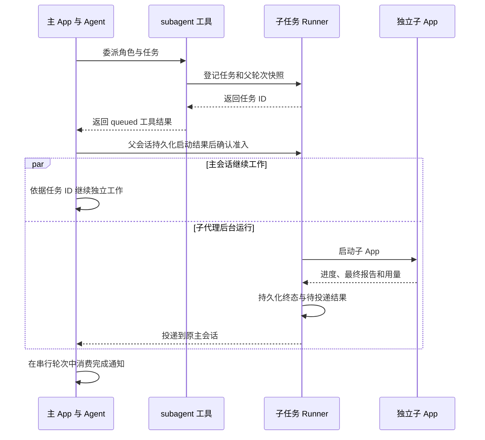

# Atlas 子代理设计方案

状态为提案，供评审。本文以当前 Atlas 与本地 zcode 源码，以及 Claude Code 的公开文档和工程文章为依据。

## 1. 首版范围

Atlas 提供一个 `subagent` 工具，内置两个只读角色 `explorer` 和 `verifier`。主模型根据角色描述自动委派，用户也能通过 `@explorer` 或 `@verifier` 显式指定本次使用的角色。每次委派启动一个独立的 Atlas `App`，拥有新上下文和裁剪后的工具集合。

从主对话发起的常规委派**默认在后台运行**。启动工具立即返回任务 ID，主模型可以继续做独立工作。执行完成后，运行时主动把报告和状态送回原主会话。首版按后台路径设计，阻塞等待接口、用户自定义角色、完整子会话查看与续跑、写入型角色和工作树留作后续演进。

典型用途包括把多目录代码检索交给 `explorer`，把需要独立核对的结论、补丁或测试证据交给 `verifier`。已知文件的单次读取、需要持续共享完整证据的调试、已有明确步骤的操作，继续由主代理使用普通工具或 Skill。

## 2. zcode 与 Claude Code 的取舍

| 设计点 | zcode 当前源码 | Claude Code 公开行为 | Atlas 首版选择 |
| --- | --- | --- | --- |
| 角色与选用 | `Agent` 接受角色类型，由 `SubagentPort` 分派。角色可来自内置、用户、项目和插件 | 主模型按角色描述选择，支持用户显式 `@` 指定。角色定义可以扩展 | 按角色描述自动选择，支持 `@` 指定，首版仅内置 `explorer` 和 `verifier` |
| 单次参数和模型 | 工具传角色、任务描述和 prompt。角色可配置模型，宿主可传内部模型覆盖或让子任务继承父模型 | Agent 调用可指定模型，角色也可声明自己的模型 | 工具只传角色、描述和 prompt。模型由 settings、角色定义及宿主内部覆盖决定 |
| 上下文和权限 | 独立 `AgentRuntime` 与子历史。工具集由角色与运行时规则投影，审批交互可路由到父会话 | 普通子代理从新上下文启动。`fork` 可以继承主会话，`worktree` 可以隔离工作区 | 独立内存 `App`、只读工具、以父工作目录为读取根。模型可用的工具由运行时控制 |
| 执行与回传 | 前台等待或后台返回 ID。Runner 维护终态，后台结果进入父会话通知队列 | 当前文档里，从主对话发起的常规子代理默认后台运行，结果通过后续完成通知交付 | 默认后台，Runner 保存任务结果，原主会话串行消费完成通知 |
| 轨迹和协作 | 子会话事件独立保存，父会话镜像部分活动。支持发消息与恢复 | 独立 JSONL，SDK 用 `parent_tool_use_id` 关联事件。Agent Teams 另有共享任务和直接通信 | 父工具行按启动调用 ID 显示进度和结果。父侧持久化任务报告，子运行过程暂留内存 |

Claude Code 的 Guide 子代理把大量文档读取留在独立上下文，再把答案交给主会话。这是 `explorer` 和 `verifier` 共用的原则。Anthropic 的 Research 复盘补充了委派任务的写法，即给子代理明确的目标、范围和返回格式。 [zcode 工具入口](../../zcode/apps/zcode-cli/packages/core/src/tool/handlers/agent.ts#L218) · [zcode 子运行时](../../zcode/apps/zcode-cli/packages/core/src/runtime/methods/subagent.ts#L134) · [zcode Runner](../../zcode/apps/zcode-cli/packages/core/src/subagent/runner.ts#L147) · [Claude Code 子代理文档](https://code.claude.com/docs/en/sub-agents) · [Claude Code Guide 的设计过程](https://claude.dev/blog/seeing-like-an-agent/#progressive-disclosure-the-claude-code-guide-agent) · [Claude Research 复盘](https://www.anthropic.com/research/multi-agent-research-system)

## 3. 发起委派

### 角色与用户指定

| 角色 ID | 主模型何时选择 | 预期报告 |
| --- | --- | --- |
| `explorer` | 需要跨文件定位实现、追调用链、了解目录或找关键证据 | 结论、相关路径和行号、未解决的问题 |
| `verifier` | 已有一个具体结论、改动或验收标准，需要独立检查 | 按检查项给出通过、未通过或证据不足，附上依据及漏测项 |

主模型只需看到角色 ID 和简短的适用条件。完整角色提示词在启动时载入子上下文。`verifier` 的委派 prompt 应给出要验证的主张、验收标准和可访问的证据。首版可以读代码与已有测试产物。需要重新跑测试时，由主会话执行并把结果交给 `verifier`。`verifier` 应明确标记只能通过重新执行才能确认的事项。

用户输入 `@explorer 查清会话落盘路径` 时，客户端把角色作为本轮输入的元数据，并把它交给主模型作为显式委派指令。主模型负责写出任务，运行时只接受指定范围内的角色。若指定角色无法启动，主会话说明原因。没有角色提及时，主模型自行判断是否委派以及选哪个角色。用户可以在同一条输入中点名两个角色，由主模型根据任务为各自组织委派。角色选择随本轮结束，下一轮重新判断。

建议在现有 `@` 补全里将角色标为独立类型，仅识别用户亲自输入或选中的角色。裸的 `@explorer` 和 `@verifier` 表示角色，同名文件可写作 `@./explorer` 或 `@"explorer"`。引用文本、附件内容和模型输出里的 `@` 保持普通文本语义。终端与桌面将角色 ID 传给同一个委派校验逻辑。 [Atlas 的文件提及解析](../cmd/atlas/attach.go#L46) · [Claude Code 显式调用](https://code.claude.com/docs/en/sub-agents#invoke-subagents-explicitly)

### 模型单次可以传什么

| 字段 | 用途 |
| --- | --- |
| `subagent_type` | `explorer` 或 `verifier`。用户本轮指定角色时接受指定范围内的值 |
| `description` | 一行任务标题，显示在父会话工具行 |
| `prompt` | 任务目标、范围、已知线索、验收条件和返回格式 |

工具 schema 只含这三个字段。工作目录、模型、权限、运行预算和后台调度由 Atlas 决定。首版结果正文建议限制在 8 KiB，截断时明确标记；子代理报告作为运行时数据交给主模型。

### 模型从哪里来

建议按下列顺序选择，命中后在启动时冻结实际 Model、Provider 和适用的思考级别。

1. **宿主内部覆盖。** 只接受可信调用方传入的运行配置，与模型可调用工具的公开参数隔开。覆盖使用的 Provider 和请求依赖必须在后台执行期间有效。宿主显式禁止后台或依赖只在父轮次有效时，启动返回不可后台运行的原因。
2. **settings 中的按角色设置。** 用户可以为 `explorer` 和 `verifier` 配置不同模型，角色 ID 仍来自内置目录。
3. **角色定义和全局缺省。** 角色有明确模型时优先使用它，未指定时使用 settings 的子代理全局缺省，最后继承父轮次实际模型。首版内置角色默认走继承链，可在 settings 中为搜索或核验单独配模型。

显式选中的模型无法解析时，回报配置错误。继承须使用父轮次当时拿到的 Provider，配置重载和主会话切模型只影响后续提交的任务。用 Atlas 已有解析器处理模型标识和思考级别适配。 [zcode 的宿主覆盖契约](../../zcode/apps/zcode-cli/packages/contracts/src/interfaces/subagent.port.ts#L24) · [zcode 后台模型依赖检查](../../zcode/apps/zcode-cli/packages/core/src/subagent/runner.ts#L187) · [Atlas 模型解析](../internal/config/lookup.go#L56) · [Agent 配置构造](../internal/app/app.go#L484)

## 4. 后台启动与完成通知

### 任务状态的所有者

- **`assembly` 组装 Runner。** 子执行复用 `session.InMemory`、`app.New` 和 `App.Ask`，每个子代理独立注册工具和管理上下文。主内核和 `OpenLiveSession` 复用同一处接线。已有 `/side` 可参考它创建内存会话的方式，子代理每次都从独立的新历史开始。 [内核创建](../internal/assembly/kernel.go#L114) · [独立会话工厂](../internal/assembly/kernel.go#L449) · [侧对话](../internal/app/side.go#L50)
- **`app` 绑定本轮快照。** 在应用待切换模型并完成工具准备后，为本轮 `subagent` 绑定角色提示、实际模型与 Provider、父会话 ID、工作目录和可用工具集合。派发工具仍沿现有 `dispatch` 运行。启动结果的 `tool.Result.Details` 带任务 ID、角色、`queued` 状态和选定模型，父工具调用 ID 用已有 `ToolCallID`。 [Ask 与工具刷新](../internal/app/run.go#L138) · [并行工具分发](../internal/agent/dispatch.go#L76) · [工具结果](../internal/tool/tool.go#L21)
- **Runner 持有后台生命周期。** 登记任务后返回 ID，父工具结果成功写入 JSONL 后，Runner 才获得执行资格。这样能用启动结果条目确认归属和分支，也避免父会话写入失败后留下无人可见的后台任务。同批若还有耗时前台工具，子任务可能等到该批结果写入后才开始。Runner 用任务 ID、父会话 ID、启动结果条目 ID 和父调用 ID 追踪任务。现有 `KindSubagent` 可作分类参考，后台取消通过 Runner 持有的取消函数完成。 [父结果持久化](../internal/app/run.go#L320) · [并行批次的结果发出顺序](../internal/agent/dispatch.go#L131) · [任务类型](../internal/task/task.go#L25) · [现有进程组停止逻辑](../internal/task/service.go#L321)

### 通知如何进入主会话

1. **结束后立即发布状态，随后投递报告。** Runner 将终态、摘要、已知用量和待投递状态一起持久化。界面按 `sessionId`、任务 ID 和父工具调用 ID 更新原工具行，展示进行中、成功、失败或取消。`verifier` 的核验结论与执行状态分别记录，例如发现验收未通过，执行本身仍可成功。父模型在收到完成通知前只知道任务状态和 ID。 [zcode 后台完成通知](../../zcode/apps/zcode-cli/packages/core/src/subagent/runner.ts#L1725)
2. **主会话串行处理。** 父轮次在运行时，通知先进入原会话的运行时收件箱。当前轮次收尾后集中交付。前台宿主中原会话空闲时，由宿主通过已有的轮次准入触发一次内部结果轮次；如果已有用户输入准入，优先随该轮读入。用户无需再发一条消息来领取报告。收件箱独立于用户的 steer 和 follow-up 队列，清用户队列时不影响结果交付。 [用户消息队列](../internal/app/run.go#L204) · [HTTP 会话准入](../internal/httpapi/httpapi.go#L483)
3. **身份和分支在消费前核验。** 按任务 ID 去重并检查当前分支包含启动结果条目。切到别的会话时结果仍属于原会话；回退或分叉到启动前时，旧报告保留在任务历史，当前分支只消费该分支发出的委派。归档或尚未重新打开的会话保留待投递结果，重新具备接收条件时交付。
4. **模型输入与界面来源明确。** 父 `toolResult` 保持启动回执。完成报告追加为带任务 ID 的 `custom_message`，在历史里显示为子任务完成。现有投影会把这类条目转成用户角色，首版需在投影内容里显式标注运行时来源，界面和授权判断则读取条目元数据。报告正文按证据处理，授权仍走既有权限流程。收件箱以父会话已写入的任务 ID 为消费凭证，重试时先查凭证。启动回执与完成报告各写一次。 [自定义消息写入](../internal/session/session.go#L528) · [自定义消息投影](../internal/session/context.go#L85)

首版建议先在 TUI 和桌面/Web 接通启动、进度和主动通知，分别沿用其现有运行状态管理。IM、RPC 和单次 CLI 在拥有相应的完成通知与生命周期承接之前维持现有工具集。后台任务超时或被停止后仍送达终态，宿主关闭时清理自己的运行；重启后可查询已落盘结果，尚无终态的任务标记 `lost`。

### 并发、取消与统计

- 建议每个主会话同时运行 2 个子代理，单次用户发起的轮次最多接受 4 个委派，派生的内部结果轮次沿用同一预算。Runner 设有界队列与进程级并发限制。单个任务建议最多 8 次 Provider 请求和 90 秒，计时从实际启动开始。各上限作为评审起点，按模型限流与任务效果调整。
- 取消未提交的父轮次可撤销尚未准入的任务。后台任务取得资格后，其取消由任务或宿主生命周期负责，后续父轮次取消和界面切换不影响它。超时、失败、取消和预算用尽均保留可用的部分报告。首版建议关闭子代理自动压缩和溢出重试，发送前检查已知模型窗口。 [上下文准入](../internal/app/overflow.go#L19) · [模型循环](../internal/agent/loop.go#L38)
- 后台用量可能在父轮次结束后才到达。完成时将子模型已知用量按任务 ID 归到父会话一次，可沿 `AppendUsage` 记录独立用量条目。启动回执和完成通知只做展示与回传。父轮尾收据保留当时已完成的主轮次用量，子任务终态单独显示消耗。Provider 未报告的失败和中断用量标为未知。 [独立用量记录](../internal/session/session.go#L450) · [会话统计](../internal/app/stats.go#L51)

## 5. 权限与读取范围

1. 父 `subagent` 调用走普通工具权限钩子。两个角色的子注册表都取父轮次可用工具与 `read`、`ls`、`find`、`grep` 的交集。子工具对照父会话权限引擎逐次判定。首版后台只执行直接获 `Allow` 的操作，需审批的调用返回限制及所需证据，让主会话承接。父权限规则继续在执行时生效。 [执行前钩子](../internal/agent/dispatch.go#L142) · [权限判定](../internal/permission/permission.go#L347) · [现有 HTTP 审批等待](../internal/httpapi/approval.go#L173)
2. 读取根固定为委派时的父工作目录。Atlas 当前文件工具的 `cwd` 用于路径解析，绝对路径和 `~` 仍可解析到其他位置。建议给四个文件工具加可选根目录访问方式，由子代理用 Go `os.Root` 做实际打开、列目录和遍历。跨根路径和跨根符号链接在实际访问时拒绝，普通会话保持其原有文件工具配置。 [现有路径解析](../internal/tool/fs/path.go#L12) · [Go 模块版本](../go.mod#L1)
3. 子会话用固定角色指令和显式传入的委派内容，可以附带宿主选择的必要项目约束。写入、Shell、网络、MCP、浏览器与再次委派均不进入子工具注册表。扫描所得材料和子代理报告进入主会话时保持工具数据语义。

## 6. 后续演进

| 能力 | 何时扩展 |
| --- | --- |
| 完整轨迹与续跑 | 需要查看原始工具调用或多次追问同一调查时，再独立持久化子会话，引入按任务 ID 查看和恢复 |
| 用户自定义角色 | 内置角色验证通过后再加入用户级 Markdown 定义。项目级或插件角色单独明确来源、优先级和权限边界 |
| 写入型角色 | 先定义变更归属、审批和合并责任。有并行写入需要时再引入独立 worktree |
| 前台等待和团队协作 | 独立评估显式等待接口、共享任务认领、直接通信或批量工作流的实际用例 |

## 7. 验收

| 验收项 | 应观察到的行为 |
| --- | --- |
| 角色选择 | 普通搜索和核验任务分别可选 `explorer` 与 `verifier`。`@verifier` 能约束本轮角色，下一轮恢复自动选择。`@./verifier` 继续作为文件附件 |
| 模型配置 | 按角色 settings、角色定义、全局缺省、继承和宿主覆盖有明确优先级。单次工具参数传入 `model` 不生效。父模型切换后，已登记任务保持当轮选模 |
| 后台默认 | 启动返回任务 ID，父模型先于子任务完成继续运行。运行中的父会话按轮次收尾交付，空闲会话主动收到结果轮次 |
| 通知归属 | 并行任务的进度和报告通过各自 ID 关联。切换会话、回退分支、重试投递或重开会话时，无串线和重复通知。父历史存有启动回执及完成摘要 |
| 上下文与权限 | 子请求只含角色提示和显式委派内容，父历史的标记文本未出现在子请求。子工具集无写入或 Shell，跨根读取与待审批操作被拦截 |
| 失败与用量 | 超时、取消、请求预算耗尽和部分结果有正确终态。完成时统计已报告用量一次。一个任务失败时其他任务仍可完成 |
| 实际收益 | 使用相同模型对比主代理独自执行和委派模式。覆盖单文件定位、多目录架构追踪和基于证据的核验，记录结论与证据准确率、主上下文占用、总 token、耗时 |

优先评审两个体验决策。第一是空闲会话自动消费报告的展示方式。第二是首版是否需要展开原始子轨迹。若需要展开，须提前纳入子会话持久化。 [Anthropic 关于何时保留子代理的建议](https://claude.com/resources/articles/building-agents-when-to-fold-subagents-into-your-main-agent-loop)
